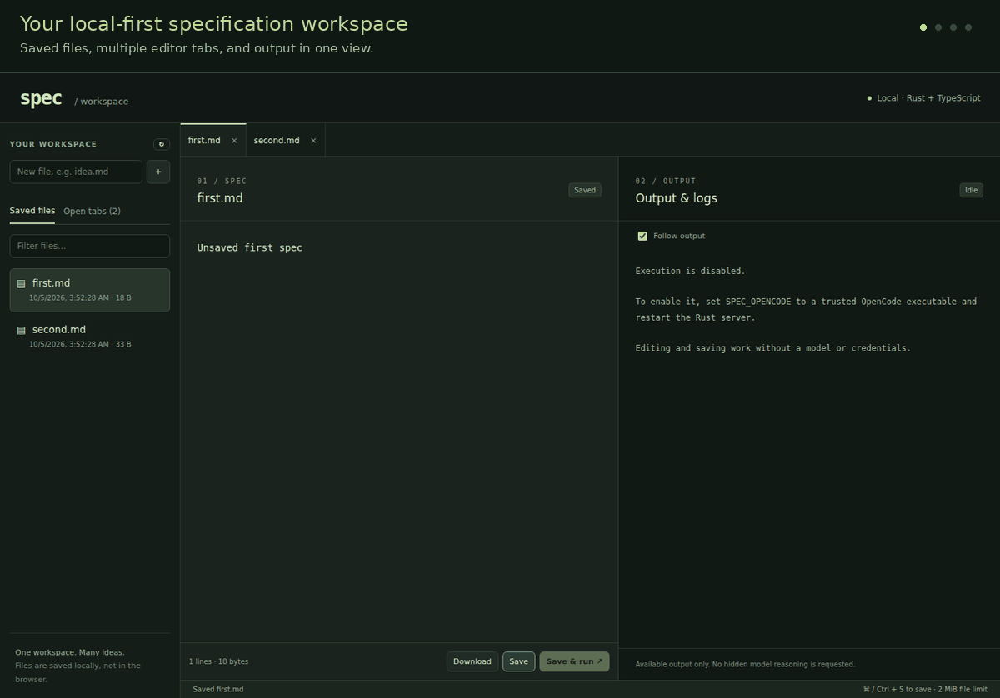

# Spec Technical Reference

A local-first **Rust backend + Vite / React / TypeScript frontend** for writing specifications and viewing build output side by side.

This is a source-derived web rewrite of [AI10xDev/specific](https://github.com/AI10xDev/specific), the project behind the development machine's `spec` shell command. “Rust++” was clarified to mean Rust, not a separate language or C++ requirement. The HTTP backend is Rust; optional staged builds delegate over SSH directly to a capability-checked OpenCode runner configured by `SPEC_WORKFLOW_RUNNER`. OpenCode is an **optional external execution engine**, not a Rust reimplementation of the model/provider stack.

## Latest release: v0.1.15

[Spec v0.1.15](https://github.com/AI10xDev/spec/releases/tag/v0.1.15) adds keyword-ranked chronological build-memory retrieval, manual private Azure Blob backups of saved specs, and clearer provider settings. Uploads are bound to the confirmed destination; memory reports remain unverified claims. The release includes practical installation and workflow guides. See the [release notes](docs/releases/v0.1.15.md) for scope, validation, and upgrade instructions.

Rebuild and restart the local server, then reconnect using its new token URL. Already-running remote supervisors are not upgraded. This is a Git-tagged source release, with no prebuilt binaries; package manifests remain at `0.1.0`, as in prior releases.

The staged build contract below describes the current implementation, not a claim
that an older release tag includes it or that a live execution host has been
upgraded. Host installation is explicit and separate from installing Spec; see
[staged builds](docs/SUPERVISED_BUILDS.md).

## Documentation

- [Start here: everyday use](README.md): plain-language installation, your first task, practical examples, and reviewing the results.
- [Installation](docs/INSTALLATION.md): prerequisites, local-first setup, remote execution, upgrades, and troubleshooting.
- [Development workflows](docs/WORKFLOWS.md): writing useful specs, reviewing results, follow-ups, teamwork, and measured optimization.
- [Staged builds](docs/SUPERVISED_BUILDS.md): Builder reports, explicit approval, Integrator sessions, host setup and runtime policy.
- [Workspace guide](docs/FEATURES.md): editing, autosave, shortcuts, conflicts, and output recovery.
- [Configuration reference](#configuration) and [AI settings](#ai-settings): server variables and optional providers.
- [Performance](PERFORMANCE.md), [Optimization](OPTIMIZE.md), and [Analytics](docs/ANALYTICS.md): specialized workflows and evidence limits.
- [Security](docs/SECURITY.md): local access, credentials, and execution boundaries.
- [Build memory](docs/BUILD_MEMORY.md): SQLite-backed GraphQL history, sweep keys, timestamps, and evidence limits.

## Workspace showcase



[View the original screenshot](Screenshot%20From%202026-10-05%2019-07-10.png). This looping tour uses the October 5, 2026 screenshot to highlight saved files, multiple editor tabs, and side-by-side specification editing and completed remote SSH build output. It is an animated screenshot showcase, not a live execution recording.

## Features

- **Saved files tab:** previously written files in the selected workspace, most-recently-modified first, with timestamps, sizes, filtering, and refresh.
- **Multiple editor tabs:** independent buffers, quick switching, dirty indicators, and confirmation before discarding unsaved edits. Reloading reopens the last selected saved file if it still exists; unsaved buffers and the full tab layout are not persisted.
- **Two panes:** the active spec on the left; that file's output and logs on the right. Smaller screens stack them vertically.
- **Reliable saves:** atomic replacement, private file permissions, and revision checks that reject stale saves instead of silently overwriting them.
- **Local file workflow:** create, edit, save, reopen, and download UTF-8 files; Ctrl/Cmd+S saves the active editor.
- **Completed spec lines:** press `/` to toggle the current line's `# ` completion marker; Alt+/ inserts a literal slash. The build agent is instructed to retain completed lines as context and implement only pending requirements.
- **Trailing completions:** optional selected-provider ghost text for the current sentence part; Tab or **Accept part** inserts it, Escape dismisses it.
- **Optional Save & run:** explicit confirmation starts Builder exploration/planning, allowing preliminary unit/smoke-test edits and experiments but not end-to-end implementation. Input is immutable, with live polling, cancellation and concurrency limits. The outer supervisor has no overall timeout; the runner enforces the host execution deadline and any numeric executing-actor token budget.
- **Approve & implement:** authenticated `POST /api/runs/{id}/approve` with `{}` starts a fresh Integrator from the latest successful Builder's original snapshot and durable validated handoff. Only this explicit action transitions stages.
- **Durable stage reports:** private records retain stage, original snapshot, validated result and approved handoff separately from capped logs. Report validation is not verification of implementation.
- **Saved editor build queue:** Save & run during an active build stores a fixed snapshot for a fresh Builder after confirmed successful finalization. Queue state survives browser/server restarts; subsequent autosaves do not change queued instructions. Queues never autoapprove integration. See [saved editor follow-ups](docs/FEATURES.md#queue-saved-editor-follow-ups).
- **Rainbow build progress:** the selected build's latest complete CLI task list drives a live completion bar; missing counts show indeterminate activity, never a made-up percentage. See [progress reporting](#build-progress-reporting).
- **Same-stage feedback:** **Send & revise builder** / **Use recommended & revise builder** stay in the Builder session. **Send & continue** / **Use recommended & continue** stay in the Integrator session and approved scope. Neither uploads editor changes or grants stage approval.
- **History-aware planning:** initial builds, continuations, and prose optimization agents are instructed to read relevant previous `.out` spec outputs before planning. They reconcile completed features/refactors and validation evidence with the current code, avoid repeating confirmed work, and flag missing or uncertain evidence. This is an agent-driven review using file tools, not a completion flag inferred from a successful run; snapshots and completion markers remain unchanged.
- **Structured build memory:** each admitted build or continuation has a separate sweep record with job/session/parent keys, spec revision, observation times, and agent-reported changes, reasons, checks, and unresolved work. Read previous jobs through the authenticated [memory GraphQL API](docs/BUILD_MEMORY.md); agent claims remain separate from verified operational status.
- **Analytics:** select a saved spec's `.out` report for read-only metric charts and optional validated `.eval` checks, with missing-report and incomplete-evidence warnings. See the [format and limitations](docs/ANALYTICS.md); local snapshots have no verified terminal status.
- **Performance:** runs the existing built Gemma RL workflow through a fresh builder session for a remote project folder. Optional unsaved editor instructions accept any filename extension. Admission, recoverable output, and cancellation are independent of spec runs. See [performance](#performance) below.
- **Save repo changes:** shown only when the configured remote directory belongs to a Git worktree with uncommitted changes. Uses the saved AI profile (or `azure/gpt-6-sol` fallback), the existing repository workflow, and the saved spec as context.
- **Recoverable output:** reopening a saved spec restores its latest build output after browser or server restart, without rerunning the build.
- **Separate session chat:** ask about the current nohup output, written spec, or general topics in a dedicated browser window, without adding chat to the editor/output panes.
- **Voice and context tools:** independent OpenAI and Azure Realtime voice panels, current/last-answer context inspection, and a revision-checked Agent.md editor.
- **Accessible responsive styling:** dark, rainbow-accented UI with visible keyboard focus, reduced-motion support, forced-colors fallbacks, and narrow-screen layouts.
- **Local API protection:** loopback binding, a random access token, no permissive CORS, constrained filenames, and symlink rejection.
- **Private spec backups:** Settings includes Azure Blob Storage account/key/container settings and an explicit **Upload all specs** action. See [Azure Blob Storage](#azure-blob-storage).

The output pane displays available stdout/stderr and explanations. It does **not** request or expose hidden model chain-of-thought.

Read the [current code review and feature report (2026-10-28)](docs/CODE_REVIEW_2026-10-28.md), [original workspace feature guide](docs/FEATURES.md), [historical code review](docs/REVIEW.md), [security notes](docs/SECURITY.md), and [source collection notes](archive/README.md). This reference and the linked workflow guides cover the newer execution and AI features.

## Quick start

Requirements: Linux, Rust/Cargo (tested with 1.98), and Bun (tested with 1.3.14) or Node.js 22.12+ with npm. Bun is recommended for reproducible frontend installs using `bun.lock`; the launcher's npm fallback does not use that lockfile. These tools are used for frontend dependency management/building only. The backend uses Unix file locking and process groups; Windows is not supported by this version.

```sh
git clone --branch v0.1.14 https://github.com/AI10xDev/spec.git
cd spec
unset SPEC_COMMAND
./run.sh --local
```

`./run.sh --local` installs frontend dependencies, typechecks/builds the UI, and starts the release Rust server without SSH. No model credentials are required for editing. It does not disable any AI providers you have already configured. Stop it with Ctrl+C.

Without `--local`, `run.sh` loads the remote host from `~/ip` (user `opencode`), uses the local key `$HOME/Downloads/Spec_man.pem`, and creates remote `~/project` if missing. Those are machine-specific defaults: configure `SPEC_SSH_TARGET`, `SPEC_SSH_KEY`, and `SPEC_SSH_WORKSPACE` for your own host before enabling **Save & run**. See [remote setup](docs/INSTALLATION.md#enable-remote-builds). The launcher can be invoked from any working directory; relative workspace/UI paths are resolved from `backend/`.

For future builds without starting the server, run `./build.sh`. It installs frontend dependencies, typechecks/builds the UI into `frontend/dist`, and builds the release backend in `backend/target/release/spec` (or your configured Cargo target directory). No SSH key is needed to build the app. `run.sh` uses this same build script before launching.

New workspace directories are private. If an existing workspace is writable by group/others, startup stops without changing its permissions. Choose another trusted directory or explicitly run `chmod go-w -- /path/to/workspace` before retrying.

Open the **full URL printed by the server**, including `#token=…`. Production frontend assets are served by Rust from `frontend/dist`; there is no separate frontend server to start. The default address is `http://127.0.0.1:4780` and the default file workspace is `workspace/` at the repository root. Keep the printed token private.

Create `idea.md` in the left sidebar, enter text, and click **Save**. Edited active sheets also autosave after 500 ms while the workspace window is focused; untouched new files do not. A failed write pauses autosave until an explicit Save retry, and revision conflicts require reconciliation. Check that the unsaved indicator clears before leaving. The file now appears in **Saved files**, including after restarting the server. Create or open a second file to get another editor tab.

### Use existing specs

From the repository root, select an existing **trusted, flat directory**:

```sh
SPEC_WORKSPACE="$HOME/specs" ./run.sh --local
```

The original shell function mirrors specs into `$HOME/specs`, so this can display those previously written files directly. **This edits the selected files in place.** Back them up first if needed. This version does not automatically read `~/.local/state/spec/saved-files` or traverse unrelated paths from that history. Nested folders, hidden files, symlinks, and non-UTF-8 files are not editable.

Files are limited to 2 MiB and filenames to 180 UTF-8 bytes; the workspace is flat and has no rename/delete API. A stale save preserves your unsaved buffer rather than overwriting a newer disk revision. See [save conflicts and recovery](docs/FEATURES.md#5-save-conflicts-and-download).

### Azure Blob Storage

Open **Settings**, scroll to **Azure Blob Storage**, and enter the storage account name, an existing private container name, and either account access key (`key1` or `key2`). These are storage credentials, not Azure OpenAI credentials. Only Azure public-cloud endpoints (`https://<account>.blob.core.windows.net`) are supported; SAS tokens and connection strings are not accepted.

Choose **Save storage settings**, then **Upload all specs**. Saving configuration alone does not upload anything. Confirming the upload sends a snapshot of saved, top-level UTF-8 workspace documents up to 2 MiB each, including extensionless specs. Unsaved editor buffers, `.out` logs, `Agent.md`, hidden files, directories, symlinks and unsupported files are excluded. Review the uploaded/skipped/failed counts; a failed or interrupted request can still have uploaded some files, so retrying overwrites matching blob names. Existing unrelated blobs and local files are never deleted. There is no automatic sync, remote-workspace traversal or download/restore action.

The backend checks container ACLs before the batch and before each block-blob upload, rejecting public blob/container access. It does not create containers, alter ACLs or generate public links/SAS tokens. Keep Azure anonymous access disabled: an administrator can change container permissions after an upload. Use a dedicated account/container when practical, since account access keys grant broad storage access.

Storage credentials are separate from AI settings and build handoffs. They persist in a sibling `<SPEC_SETTINGS_FILE filename>.storage.json` file (default `profile.json.storage.json`) under the same private settings directory, with `0700` directory and `0600` file permissions, outside served roots. APIs return only the account/container and whether a key is configured. An omitted key is retained only for the same account. **Remove storage settings** removes the saved configuration/key, not remote blobs. Storage changes and concurrent uploads are blocked while a batch runs; uploads continue if the browser disconnects. All storage APIs require the workspace bearer token: `GET/PUT/DELETE /api/settings/storage` and `POST /api/settings/storage/upload`. Upload requires a JSON body with the confirmed `accountName` and `containerName`; a destination mismatch returns `412` before any Azure request (reopen Settings and confirm again). Rotating the key at the same destination does not invalidate confirmation.

### Remote staged execution (local web server)

The **browser, Rust web backend, and editable workspace run on your local computer**. **Save & run**, approval and continuation invoke the configured staged runner directly over SSH. **Performance** starts its own separate remote builder session for the built Gemma RL workflow. Repository-save and Optimize also retain their separate behavior. No remote web backend, HTTP port forwarding, or remote frontend build is needed.

`./run.sh` configures remote execution automatically using the defaults above. To choose another host and directory, start the app on your **local computer** like this:

```sh
# One-time SSH setup: connect interactively and verify the host fingerprint
# through a trusted channel before accepting it. Load an encrypted key into
# ssh-agent if necessary; builds cannot prompt for passwords/passphrases.
ssh -i "$HOME/.ssh/spec_ed25519" user@build-host
# Exit the remote shell, then run these commands LOCALLY:
unset SPEC_COMMAND
SPEC_SSH_TARGET="user@build-host" \
SPEC_SSH_KEY="$HOME/.ssh/spec_ed25519" \
SPEC_SSH_WORKSPACE="/home/user/project" \
SPEC_WORKSPACE="$HOME/specs" \
./run.sh
```

Adjust the host, local key path, and remote project directory for your environment. `SPEC_SSH_TARGET` also accepts a trusted host alias from your local SSH configuration (including its port/ProxyJump settings). Set `SPEC_SSH_KEY=` to use your SSH agent/default identities with the launchers; omitting it selects the default key above. Keep private keys **on the local computer**; never paste key contents into a spec or commit them. Builds use batch SSH with strict host-key checking, no TTY, no agent/X11 forwarding, and no port forwarding. Unknown hosts, inaccessible keys, and connection/authentication errors fail startup or appear in run output; they do not fall back to local execution.

#### Repeatable remote-build launcher

`./ops.sh` delegates to `run.sh` with the local editor workspace defaulting to `$HOME/specs`. Both launchers check SSH and create remote `~/project` if missing before starting the local app. Override those defaults with the variables above. The key path is converted to an absolute path before starting the backend.

```sh
# One-time key permissions, then build and launch with the defaults:
chmod 600 "$HOME/Downloads/Spec_man.pem"
./ops.sh
# Use another existing local private key:
SPEC_SSH_KEY="$HOME/.ssh/your_existing_key" ./ops.sh
# Or use identities already configured in SSH config/ssh-agent:
SPEC_SSH_KEY= ./ops.sh
# Build the app without starting it:
./build.sh
```

To build **all specs already in remote `~/project`** without starting the web app:

```sh
./remote-build.sh --check   # Connect, create the directory if missing, list inputs
./remote-build.sh           # Build each spec serially in that remote directory
```

This legacy batch helper uses the same host/key settings as `ops.sh`, but not the web app's staged approval API or durable report contract; it still invokes `spec build`. Set `SPEC_SSH_WORKSPACE=/absolute/remote/path` to override the directory. Only top-level regular `.md`, `.txt`, `.spec`, and extensionless files are inputs; hidden files, symlinks, subdirectories, and output logs are excluded. Local specs and remote `~/specs` are not automatically copied. An empty directory prints “No specs found.” Each invocation writes separate logs under remote `project/.spec-runs/batch-*/`, continues after individual failures, and exits nonzero if any build fails. Keep SSH connected until the batch finishes. Use `ops.sh` and **Save & run** for the web app's staged detached per-file builds.

Both `./ops.sh` and `./run.sh` check an explicitly supplied key before building and convert relative paths (from your current directory) or literal `~/` paths to absolute paths. An empty key is treated as unset. Launching the Rust binary directly still requires an absolute key path.

The error `SPEC_SSH_KEY must be an absolute local private-key file path` could previously mean either a relative path **or a missing file**. The backend now distinguishes those cases. A key must exist on the computer running the local server; a path on the remote host does not work. If this computer has no authorized key or configured SSH identity, provide one before using **Save & run**.

To trace a legacy local `spec` command, check `type spec` in your interactive shell. In the Specific installation, `~/.bashrc` sources `~/.local/share/specific/shell/specific.sh`; its `spec build` function calls `bin/specific-run-build`, which invokes `opencode run --agent build`. That is not the staged web-build entrypoint. OpenCode provider credentials may be configured in `~/.config/opencode/opencode.jsonc`. Those API credentials authenticate model requests, not SSH connections, and cannot be used as `SPEC_SSH_KEY`. Remote builds need their own working SSH identity and OpenCode configuration on the remote host.

Open the full localhost URL printed by the **local** Rust server, including its token. **Save & run** first saves locally, then sends just that immutable spec snapshot over SSH. Other local project files are **not synced**. The remote build works in `SPEC_SSH_WORKSPACE`; its file changes remain remote. Prepare that remote checkout separately. `SPEC_WORKSPACE` is the local editor directory and is independent of the remote build directory.

**Ctrl/Cmd+Enter** invokes **Save & run** from the editor with the same confirmation and busy/run guards as the button. **Ctrl/Cmd+S** still saves without running. The editor displays wrapping-aware line numbers and source syntax colors, including completed `# ` lines, headings, lists, inline code, and fenced code. These are display-only: saved text is unchanged. Output uses severity colors and ANSI text styling; terminal control commands and embedded HTML are never executed.

For responsiveness, files over 256 Ki characters or 5,000 lines use a labeled plain-text editor, and lines over 1,024 characters skip inline coloring. Dense logs (over 2,000 line breaks or 4,000 ANSI text segments) also fall back to sanitized plain text. These display limits do not truncate content or lower the existing save limits.

#### Build progress reporting

The rainbow bar and read-only step checklist appear above the associated build
output and in the selected build's Active runs detail. They update with the
existing live poll (normally every 650 ms). The bar counts only the executing
stage's latest complete `# Todos (Builder)` or `# Todos (Integrator)` snapshot.
`# Todos (Supervisor)` is displayed separately as optional advisory progress and
never affects the execution percentage. The runner forwards structured
`todo.updated` events and resets lists for every sweep. Unlabeled `# Todos`
snapshots use the current stage; legacy unstaged runs treat them as Integrator
reports. ANSI styling and fenced examples are ignored. Cancelled tasks stay in
the total but do not count as completed. A revised task list can
lower the percentage; these are agent-reported tasks, not independently verified
requirements, elapsed-time estimates, or progress inferred from editor `# ` markers.

Before task counts arrive, unsupported log formats and partially streamed lists
show indeterminate activity while the build runs. A partial, cleared or invalid
executing-role snapshot hides the percentage without erasing the other role's
checklist; missing advisory tasks do not hide execution progress. Truncated output
also has no percentage because the complete task-list context is unavailable. Activity stops
on terminal or unavailable states; unavailable states label any last reported
counts as potentially stale. A successful CLI exit alone never fills the bar.
Likewise, 100% reported tasks does not mark a running process complete: the build's
status must independently reach `completed` before the UI says the stage run completed.
New runs and continuations start fresh, and switching files follows that file's
run. Retained historical views, repository-save jobs, and Performance output do
not display this build-task bar. Reduced-motion and forced-colors settings are
supported, with textual counts and accessible progress values.

#### Save edited repository changes

**Save repo changes** appears only for a connected, dirty Git worktree in `SPEC_SSH_WORKSPACE` (the remote build directory, not the local editor directory). Status refreshes every five seconds; probe errors hide the button. Staged, unstaged, and untracked files count, but `.spec-runs/`, `.spec-output/`, and `.spec.lock` do not. Select a nonempty spec as context to enable the button.

After explicit confirmation, the UI saves the active spec locally and submits its revision to `POST /api/repository/save`. The backend rechecks the repository and unfinished harnesses, then uses the existing SSH `spec build` launcher with the saved AI profile (or `azure/gpt-6-sol` when none is saved) and repository-save instructions instead of implementing pending spec requirements. Existing instructions and repository workflow are preserved. The model is instructed to validate and make focused commits, excluding secrets, session artifacts, and unrelated edits; pushing, amending, resetting, and bypassing hooks are not authorized. The remote launcher must honor the supplied OpenCode configuration.

An active or unresolved harness blocks repository saves, including runs for other specs. The remote supervisor also excludes overlapping launches and refuses saves when a prior session lacks a valid terminal `status`. Inspect that session rather than assuming missing status means success. Output, cancellation, and recovery use the same **Output & logs**, **Stop run**, and **Load nohup output** controls. Logs are per-session `<spec filename>.out`, not a shared `nohup.out`. A `completed` harness means CLI exit success only: inspect its reported commit and validation results to confirm the changes were saved. No repository commits or provider calls happen merely by checking status.

#### Remote shell requirements

The remote machine needs Linux, Bash, `setsid`, `flock`, GNU coreutils (including
`stdbuf`), findutils, Python 3 for result recovery, Bun for the staged runner, and
a configured V2-capable OpenCode engine. It does **not** need this Rust web server
or a remote frontend build. Optimization has additional requirements below.

The host owner must explicitly install OpenCode from
[`AI10x/opencode-fork`](https://github.com/AI10x/opencode-fork), `main` commit
`e60a017d878486eb6b143e55cb9b9f320091d46d`, or an equivalent staged implementation,
including its scripts/dependencies and a rebuilt compatible engine. Configure
`azure/gpt-6-astra` remotely; it is required in both stages. `azure/gpt-6-sol` is
optional read-only advisory and never gates startup, tools or completion. Clear
selected execution profiles; staged builds reject them rather than replace Astra.

Builds, approval and continuation explicitly source trusted remote
**`~/.bash_aliases`** in noninteractive Bash. Configure this there, outside any
interactive-shell guard, using the actual absolute executable path:

```sh
export SPEC_WORKFLOW_RUNNER=/absolute/path/to/script/run-spec.sh
# Optional custom engine executable location:
export PATH="$HOME/path/to/engine/bin:$PATH"
```

The adapter requires that runner to be an executable file at an absolute path.
It probes `"$SPEC_WORKFLOW_RUNNER" --workflow-version` under a short timeout and
accepts only exit 0 with exactly `spec-workflow-v1` plus a newline. It then invokes
that **same executable directly** with the immutable snapshot path. The probe
must not load policy, start an engine or perform provider work. There is no
`spec build` wrapper fallback for staged builds, approval or continuation.

Before sourcing aliases, the adapter prepends `~/.local/bin` and `~/.bun/bin` to
PATH. Interactive `.bashrc` and login profiles are not loaded. The runner uses
`SPEC_OPENCODE`, otherwise its checkout's host-specific compiled engine if present,
then an executable `opencode-source` on PATH; an interactive engine alias is not
sufficient. Spec does not deploy the host engine, runner, policy or credentials.
Rebuild/restart the actual SSH-launching Spec backend to embed its updated adapter.
No live host deployment or provider validation was performed for this doc update.
For a complete host-owner walkthrough, see
[external runner installation](docs/INSTALLATION.md#install-the-external-runner).

The adapter clears inherited stage/session/handoff/result settings and supplies
the admitted invocation's metadata. It sets `SPEC_BUILD_SUPERVISED=1` and
`SPEC_BUILD_FOREGROUND=1 SPEC_BUILD_AUTO=1`, but explicitly overrides
`OPENCODE_PERMISSION_AUTO_ALLOW_ALWAYS=0 OPENCODE_QUESTION_AUTO_RECOMMEND=0`.
The runner allows read/edit, denies `task`, `external_directory`, `glob` and `grep`,
and automatically replies **once** to other permitted, correlated executing-session
tool requests. No global `always` grants are saved. Use `read` for directory
listings or scoped commands for search; glob/grep lack canonical confinement in
the current V2 core.

**Runtime questions are not autoanswered**, even recommended options. The runner
rejects them with guidance to report the question, options and blocker for user
feedback. Rejection is not approval; there is no live browser runtime-answer
channel. A user-clicked recommended-choice continuation is a separate, explicit
same-stage follow-up. Sol may only read and update its own todos; its requests,
errors, missing model, timeouts and block/fix advice never veto execution.

The trusted runtime policy is `~/projects/Agent.md` or an absolute
`SPEC_AGENT_POLICY` override, reloaded per invocation. Missing/invalid policy
blocks startup. The versioned [Agent.md](Agent.md) is a repository snapshot, not
deployed policy; its external targets remain unchanged. Its older model-review
and allowlist descriptions do not change current semantics: policy rules and
CLI/account/region/infrastructure lists are advisory, not a shell allowlist, IAM
or sandbox. `reviewTimeoutMs` bounds optional advice; `maxFixes` is parsed without
a forced repair loop. Numeric `maxTokens` limits the executing actor's reported
tokens per sweep, excluding Sol; `null` disables that cap. `runTimeoutMs` remains
an execution deadline. Use provider quotas and OS/IAM isolation for hard limits.
See [runtime policy](docs/SUPERVISED_BUILDS.md#runtime-policy).

Repository-save still uses the trusted `spec build` alias/function and its existing
auto flags, not this stage transition. Optimize and Performance remain separate
and do not source the build alias file. Do not resolve a legacy `spec` launcher to
this Rust web-server binary. Archived scripts are provenance, not deployed config.

#### Sessions and cancellation

Builds (including continuations), repository saves, and optimization have **no overall supervisor runtime limit or UI attachment deadline**. The agent-output cap and retention policy below apply to ordinary builds and repository saves; optimization has separate reporting and retention rules described under [optimization](#optimization).

The staged runner inside that supervisor still enforces the host policy's
`runTimeoutMs` and any numeric executing-actor `maxTokens` budget; an outer
keep-alive saying "no execution timeout" does not disable those inner limits.

The build adapter supplies supplemental OpenCode instructions without rewriting the saved snapshot. A single leading `# ` after optional indentation marks only that line completed; removing it reopens the requirement. `##` headings, inline hashes, and hashes in code blocks are not completion markers. The `/` editor shortcut preserves indentation and native undo; inside fenced code it types a normal slash. Use Alt+/ for literal slashes elsewhere. The remote adapter needs Bun or Node to merge these instructions into OpenCode configuration; the remote launcher must honor that configuration.

Snapshot text is sent as data over SSH stdin, never interpolated into shell code or included in the SSH command line. After a complete upload, a detached supervisor owns the build and its `0600` snapshot in a `0700` run directory under `SPEC_SSH_WORKSPACE/.spec-runs/`. That parent directory must be owned by the remote user, private (`0700`), and not a symlink. The temporary uploaded snapshot is removed after process cleanup on exit or cancellation; the original staged snapshot remains in private local run records for approval/recovery. Later local saves do not change the running input.

**Closing SSH, stdin EOF, closing the browser, and normal server shutdown do not cancel an uploaded build.** The supervisor ignores SIGHUP (no-hangup behavior), runs in its own session, and writes output to a private file rather than the SSH socket. Instead of a shared `nohup.out`, each run uses `<spec filename>.out`, for example `idea.md.out` or `idea.out` for an extensionless spec named `idea`. The full filename and separate run directories keep logs distinct across specs and repeat builds. SSH only tails that log. **Stop run** sends an explicit cancellation control byte after the snapshot; the supervisor kills the build's process group, including ordinary descendants. Normal process exit still ends the run. Stop cannot be guaranteed through a broken connection; an unconfirmed cancellation is reported as detached rather than cancelled.

Every 60 seconds while the child process remains alive, the supervisor appends a message such as `[remote] keep-alive: build still running (60s elapsed); no execution timeout.` The mode is `build`, `repository-save`, or `optimize`, and elapsed seconds increase over time. This reports process liveness, **not model progress**. The 10-second startup-readiness check, cleanup safety timers, SSH network keepalives, and individual provider/tool timeouts are unchanged.

**Deployment:** the Rust backend embeds the supervisor and sends it over SSH. Rebuild and restart the actual backend launching your SSH runs, not just a backend or checkout on the execution VM. Already-running supervisors retain their original behavior, including any older watchdog deadline.

The output pane prints `[remote] session: /absolute/path/.../run-...`. On the remote host, recover using that exact directory (or list `.spec-runs/` if the connection ended before the notice arrived):

```sh
cd /home/user/project/.spec-runs/run-REPLACE_WITH_ACTUAL_ID
tail -f -- 'idea.md.out'       # Use the spec's log name; Ctrl+C stops viewing, not the build
cat status                    # Absent while running; published atomically after cleanup
touch cancel                  # Explicitly stop a still-running detached build
```

`status` contains the CLI exit code: `0` success, `124` a child timeout or an older supervisor's watchdog timeout, `130` cancellation, or `125` supervisor error (these reserved codes can also be returned by a launcher). Staged completion additionally requires a validated result; neither establishes correctness of generated changes. `<spec filename>.out` merges stdout/stderr and retains the **first 8 MiB of agent output**; excess agent output is drained/discarded without breaking the log pipe. Supervisor keep-alive messages bypass this cap, so the total log can exceed 8 MiB and slowly grows while the process stays alive. Files are `0600`; they can contain sensitive spec/tool output. The browser keeps only the latest 256 KiB it received. Recovery reads a bounded latest-256-KiB tail for all modes, including uncapped optimization logs. Recovery also reads legacy `output.log` files for sessions launched before this naming change, including builds still running during an upgrade.

The staged `result.json` is read separately after successful remote status, not
parsed out of the truncated log. Its exact envelope is
`{"version":1,"stage":"builder","report":"Concrete handoff/report"}`; results
allow `builder` or `integrator`, while approved handoffs must use `builder`.
The report must be nonempty and at most 120 KiB UTF-8. Private file checks,
provenance, stage matching and strict envelope validation reject unsafe, malformed,
oversized or mismatched results. A missing/invalid successful result fails staged
completion; transport failure leaves it unresolved for recovery. The UI's separate
stage report remains usable when the runtime log is truncated, but its claims
still require human review and actual validation.

Completed run directories older than seven days are pruned on the next launch in that remote workspace. There is no background retention service or strict total disk quota; manually remove finished directories sooner if needed. Do not delete a live run directory. Host reboot, SIGKILL of the supervisor, disk failure, or children that deliberately create separate process groups remain outside the guarantee and may leave stale snapshots or missing status. Missing status is not proof of a live build after such a failure.

Keep `.spec-runs/` out of remote version control and artifact uploads, for example by adding it to that checkout's `.git/info/exclude`. Private filesystem permissions do not prevent a same-user tool from reading or committing session files.

Run records and latest-run associations persist privately in the local workspace's `.spec-output/` directory. After restarting the server, connect using its newly printed token and open the spec from **Saved files** to restore its latest output and status. Live or unresolved sessions resume polling; **Load nohup output** explicitly rereads the latest associated remote log without launching a build or replacing the editor buffer. Recovery requires the same remote configuration for unfinished sessions; cached finished output remains available without SSH. **Stop run** explicitly cancels a recovered session. Unresolved sessions count toward concurrency limits and block another run for the same file. Recovery retrieves logs/status and staged results; continuation is a separate explicit action described below. Local records have no automatic disk pruning; protect them like specs because they can contain sensitive runtime output.

Staged records additionally retain the original snapshot, stage, validated result
and approved Builder handoff for Integrators. Recovery also retrieves the separate
stage result where required; it never infers approval from logs or starts integration.

An SSH attachment exiting **255** does not establish that the remote build failed. It is shown as detached with remote completion unconfirmed; older cached logs may still contain `[failed (exit status: 255)]`. If **Load nohup output** also reports an SSH exit 255, inspect its error for connectivity, authentication, or host-key failures, restore access, and retry loading rather than starting another build. Cached output and unresolved-run guards are preserved. A successfully loaded remote status file containing `255` is different: it confirms that the remote command failed, and the UI keeps that failure visible.

If the associated remote run directory is missing, **Load nohup output** preserves available cached output but cannot recreate the log. Use **Browse retained runs** to list other private, spec-named logs in the configured remote workspace, then explicitly select a run by UUID and **log updated** timestamp. This requires Python 3.7+ on the remote host. The read-only snapshot is separate from the associated run: it does not relink local records, clear unresolved status, enable continuation/cancellation, or change session chat context. Another run may have used different instructions. **Return to associated output** restores the original view. Discovery excludes ambiguous legacy `output.log` files and unsafe storage; the reserved name `optimization` additionally requires matching initial-build metadata to avoid mixing optimizer logs with an ordinary spec. A bounded scan reports when its list is incomplete. Viewing logs never launches a build.

#### Approve a Builder report

**Save & run** begins a Builder exploration/planning sweep. Preliminary unit/smoke
test edits and experiments are allowed, but end-to-end implementation must wait.
Only explicit **Approve & implement** sends authenticated
`POST /api/runs/{id}/approve` with the empty JSON object `{}`. Extra fields are
rejected. The backend requires the latest successful Builder on the same remote,
a durable original snapshot and validated report, and no unresolved/attached state
or persistence error. It also reads the current saved spec and requires its content
to match the original snapshot exactly; missing/unreadable or changed saved specs
are ineligible. A pending (waiting) saved-build queue entry for that Builder also
blocks approval. These are server-side admission checks, held with the document
and job locks through child registration, not merely disabled UI controls. The
backend rechecks the authoritative saved checkpoint. Active, failed, stale, legacy,
Integrator and already-approved runs cannot be approved.

Approval creates a new Integrator run and **fresh executing engine session**, with
the original saved snapshot and approved Builder report. It does not send editor
changes or feedback drafts. The UI blocks approval while edited requirements,
feedback drafts or queued revisions need resolving; changed requirements need a
new Builder report. Saving, feedback and either queue never autoapprove. The
Integrator further explores and implements the approved work end-to-end, including
integration/verification. Its handoff is context, not new tool permissions.

The external Spec backend binds approval to the report. Setting runner stage and
handoff environment variables standalone is not a secure human-approval boundary;
the runner does not cryptographically verify user approval or transition itself.

#### Continue a completed build

Builder feedback uses **Send & revise builder** or **Use recommended & revise
builder**. Integrator feedback uses **Send & continue** or **Use recommended &
continue**. These immediately resume the same captured session **in the same
stage**, not a fresh Integrator. Recommended-choice feedback is a user action,
not automatic answering of runtime questions or approval to implement. A confirmed
successful latest staged run, durable validated report, session metadata and the
same remote configuration are required. Legacy runs need a new Builder.

The feedback input accepts **Enter** to submit and **Shift+Enter** for a newline.
While running, **Queue follow-up** holds one browser-memory message per run for
the same stage/session after confirmed success. Keep the page open for delivery;
this is not live stdin or immediate steering. Stop, failure, replacement or delivery
errors pause it; ambiguous errors are not retried automatically. A saved-editor
queue is different: it persists a fixed snapshot across browser/server restarts
and launches a fresh Builder after confirmed success. Neither queue approves
integration.

`POST /api/runs/{id}/continue` accepts `{ "message": "Your feedback" }`, preserving
exact text up to 16 KiB UTF-8 (nonempty after trimming, no NUL bytes); `{}` uses the
fixed recommended-choice prompt. Editor changes are not sent. Drafts stay scoped
to the run and are retained on submission failure. Tool permissions still use the
runner's automatic per-request once replies and can modify remote files and incur
costs, subject to the stage instructions.

Continuation invokes the same capability-checked `SPEC_WORKFLOW_RUNNER`, with the
captured `SPEC_BUILD_SESSION_ID` and unchanged stage. The runner writes the executing
session ID to private `session-id` metadata; there is no legacy capture-plugin or
direct `opencode-source run` continuation route. Each sweep has a new harness/log
directory. Integrator follow-ups always receive the original approved Builder
handoff via `SPEC_BUILD_HANDOFF_FILE`, not a newly inferred approval or substituted
Integrator report. Preserve the same host engine storage/configuration.

Duplicate requests for an older run are rejected once its continuation is submitted. Missing session metadata and local SSH spawn failures leave the original run retryable. After SSH starts, failures (including remote launcher/configuration rejection) do not restore the old run's retry eligibility: the adapter cannot safely assume the engine did not execute. Inspect the logs and remote session before starting a new build; there is no automatic retry or failed-run continuation.

Build snapshots remain capped at **120 KiB**; editing/saving support 2 MiB. This
limit predates staged execution and accommodates legacy launchers that forward
prompts as one Linux process argument. The staged adapter passes a snapshot file
to the runner, not spec text in shell command syntax.

`SPEC_COMMAND` and local build execution have been removed: unset the old variable and use the SSH settings above. No model credentials are needed locally for editing or SSH builds. Validation uses an isolated SSH stand-in running the actual remote supervisor and alias scripts; no live SSH host or provider call is required by tests.

### Performance

Click **Performance**, enter a project folder relative to `SPEC_SSH_WORKSPACE` (or an absolute execution-host path), and click **Run Gemma RL (built)**. No editor tab or prior spec session is required, but the workflow and its prerequisites must already exist. Check **Use current editor as instructions** to include unsaved builder instructions without saving locally. Prose, JSON, and any filename extension are accepted.

To find a folder by name, enter a name fragment and click **Search with Explore**,
then choose a path from **Matching projects**. Search covers up to three directory
levels below the remote workspace's parent, excluding hidden/dependency/build
directories and symlinks. The Explore agent ranks a bounded directory-name
inventory with all tools denied; only names/paths, not file contents, reach the
configured model. Search is explicit and may incur model costs. Selection fills
the path without starting a run. See [project name search](PERFORMANCE.md#project-name-search)
for scope, limits, configuration and privacy details.

The fresh builder session inspects the selected project's existing documentation and configuration to run the built Gemma RL implementation, not the distillation pipeline. It is instructed not to rebuild, download models/data, fabricate data or evaluators, or substitute synthetic results. Missing prerequisites must be reported honestly. This is trusted tool execution, not a sandbox: it can write artifacts and incur compute/provider costs. See [PERFORMANCE.md](PERFORMANCE.md).

**Performance output** shows session logs and reported measurements. **Recover latest Performance** restores its latest session; **Stop run** there cancels only that Performance session. Its own active/unresolved runs and unavailable status block duplicate Performance launches. Spec runs, including unknown or missing-directory `ref_web` runs, remain in **Active runs** and do not block Performance. Performance requests do not unlock or take over spec saving, autosave, continuation, or cancellation guards. Isolation is lifecycle bookkeeping, not protection against two authorized workflows modifying the same remote files.

### Optimization

The shipped recursive optimizer remains available through its standalone CLI and the existing authenticated `POST /api/optimize` request shape `{"name":"instructions.md","content":"..."}`. It is separate from the button's `POST /api/performance` request. The spec name no longer needs an extension. Content is uploaded to a unique private file under the remote host's `~/projects/`; no local save occurs. Discovery still uses recorded build invocation metadata and narrowly supported nohup history, with a legacy fallback; it can select a project outside `SPEC_SSH_WORKSPACE`. Missing or ambiguous targets fail with diagnostics instead of inventing objectives.

The optimizer receives the uploaded spec's **absolute remote path** and loads it directly, without searching the discovered project root. The discovered build project remains the execution directory. No project objectives or benchmarks are bundled. See [OPTIMIZE.md](OPTIMIZE.md) for complete discovery rules, schema, and examples.

The report identifies the uploaded `config` path and, once discovered, the project, filename, output, and invocation source. Invalid uploads fail without falling back to another config. Uploaded specs are retained for inspection; remove them manually when no longer needed.

Two modes share the same measurement scheduler:

- **Explicit JSON v1:** provide one-step command argv, fixed read-only scalar measurement argv, direction, tolerances, patience, and optional command timeouts for each objective. The scheduler executes these commands directly without model requests.
- **Free-form prose:** describe the improvements and real measurements to use. Model planning creates a validated plan. Each active-objective iteration runs the OpenCode **build** agent for a focused improvement, then model review, repair, and the planned validation/process command. A saved AI profile selects both planner/reviewer and builder; without one, planning/review defaults to Responses with `gpt-6-sol`. Completed spec requirements and unrelated edits must be preserved. A model's assertion of convergence cannot stop the scheduler.

Both modes require **Python 3.10+ on Linux**, subreaper support, and readable procfs on the execution host. Prose mode additionally needs OpenCode (`SPEC_OPTIM_OPENCODE`, otherwise `opencode-source` when available, then `opencode`) and a tool-capable model. A profile saved in [AI settings](#ai-settings) takes precedence for both builder and reviewer, including its credentials and provider protocol. Without a saved profile, prose mode requires Responses access to `gpt-6-sol`: the legacy optimizer reuses the connected Azure API credentials/resource and resolved OpenCode provider configuration used by `spec build`, rather than an old editor dotenv. Override those defaults with complete exported credentials (`AZURE_OPENAI_ENDPOINT` plus `AZURE_OPENAI_API_KEY`, or `OPENAI_API_KEY` with Azure variables unset), or select a dotenv using `SPEC_AI_ENV_FILE` or `KIBI_ENV_FILE`. Without a connected Azure API entry or explicit credentials, the nearest build-project/ancestor `.env`, then `~/code.dev/.env`, remains the fallback. See [configuration precedence and syntax](OPTIMIZE.md#free-form-responses-mode) for details. Without saved settings, existing OpenCode configuration selects the builder's model. Local chat/voice dotenv settings are not transferred over SSH, and optimization does not source `~/.bash_aliases`.

#### Measured stopping

The scheduler records baselines, improves each active objective once per round, and independently remeasures **every** objective, including plateaued ones. For each objective, a stable round satisfies:

```text
abs(gain) <= absolute_tolerance + relative_tolerance * abs(previous_score)
```

Defaults are `1e-6` absolute tolerance, `1e-4` relative tolerance, and **three consecutive stable rounds**. A larger change, including a regression, resets the streak and reactivates a plateaued objective. Optimization stops only when all objectives satisfy their patience in the same measurement sweep. The difference between successive gains (`marginal_difference`) is diagnostic, not the stopping criterion: constant positive gains do not converge merely because their differences are small.

Validation must succeed on the final tool state of each model-guided step; a later tool call invalidates an earlier success and requires revalidation. Command errors, invalid measurements, provider failures, and timeouts fail the run rather than count as convergence. Plateau detection does not guarantee a global optimum or positive cumulative improvement. There is **no overall iteration, model-turn, or runtime cap**; improving, oscillating, or noisy objectives can run indefinitely. Per-command timeouts are optional, and each Responses request has its own 300-second network timeout.

#### Output and safety

If a run is active or its remote status is unresolved, open **Active runs** in the
header. The conflict message identifies the blocking filename, run ID and status.
The list includes recoverable runs from other tabs and restored server sessions,
even if their source files were deleted. **Load output** and **Check status** use
the run ID directly, without opening a file or changing its latest-run association.
The selected run is polled while the panel is open. **Stop run** requires explicit
confirmation; it never runs automatically on an admission error.

**Refresh list** reads the web backend's known state; it does not contact SSH or
prove remote completion. Without previously verified completion, missing logs,
SSH failures and changed remote settings keep a run unresolved and preserve
cached output. Restore access to the original
execution host/workspace and inspect the run, or explicitly stop it if appropriate.
Do not delete `.spec-output`/`.spec-runs` records or invent a terminal status to
bypass this guard. Resolving one run may leave other blockers. Standalone CLI runs
not tracked by this backend are still protected by remote harness admission.

**Load nohup output** also persists verified terminal status without replacing the
separate stream buffer. Once completion is recorded, a later connection failure
or backend restart cannot make that same run pending again. A still-attached local
SSH reader is asked to detach and must finish teardown before a conflicting launch.
If its control channel has already closed, inspection, cancellation and admission
fall back to authoritative remote recovery instead of treating it as perpetually
attached. A closed local channel alone never proves the remote run finished.

Legacy Optimization retains its persisted latest-run association at `GET /api/optimize` and its `/api/runs/{id}` output/cancellation endpoints. Its unresolved runs can still be inspected in **Active runs**; the **Performance output** selector does not read or replace that association. Optimization cannot use **Use recommended & continue**. Legacy spec/optimization admission guards remain separate from Performance, while local editing and saving remain available after submission.

Timestamped reports include baselines, iteration scores, signed and cumulative gains, marginal differences, stability streaks, and convergence/failure/interruption. Prose mode also reports planning, builder results, tool calls, validation, and step summaries. Full diagnostics remain in remote `progress.log`, `report.jsonl`, and bounded `commands.log` files. The browser retains the latest 256 KiB, and recovery reads a bounded latest-256-KiB tail. Like builds and repository saves, optimization has no overall supervisor runtime limit or UI attachment deadline and receives supervisor keep-alives every 60 seconds; these indicate process liveness, not model progress. Unlike ordinary builds, optimization output remains uncapped; report-bearing run directories are excluded from automatic seven-day pruning. Budget storage and remove finished reports manually.

Each command runs under a Linux subreaper that cleans up detached descendants before releasing the project lock, including on timeout or confirmed cancellation. A command leaving live descendants behind fails after cleanup. Forced SIGKILL, crashes, privileged/hostile commands, work handed to existing external services, and a broken cancellation connection remain outside this guarantee; inspect remote state before restarting work.

**This is trusted, unsandboxed execution.** Commands and model tools can change files, access credentials and the network, and incur provider costs. Prose mode sends objectives, `.optim` contents, bounded build/tool output, and measured state to model providers; reports may contain sensitive data. Instructions to preserve measurements and avoid credentials are not isolation. Review the [optimizer trust and privacy notes](OPTIMIZE.md#model-privacy-and-trust) before enabling it.

### AI settings

Open **Settings** in the workspace header to select the AI model for session chat,
trailing completions, and supported separate workflows such as repository saves
and model-guided optimization. Staged builds, approval and continuations reject
selected execution profiles and require remote `azure/gpt-6-astra`; optional Sol
advice does not replace it. Clear the profile with **Reset to environment** and
configure Astra on the execution host. One active profile is shared by everyone
using this server. Saving replaces that profile, persists across server restarts,
and takes effect without restarting. Already-running requests and builds retain
their admitted configuration. Voice settings remain independent.

| Provider | Configuration |
| --- | --- |
| Azure OpenAI | Resource endpoint, deployment name, API key. A resource-root endpoint requires an API version; `/openai/v1` uses Responses and permits a blank version. |
| Standalone OpenAI | Model ID, API key, and API base URL (normally `https://api.openai.com/v1`); uses Responses. |
| Claude API | Model ID, API key, and base URL (normally `https://api.anthropic.com`); uses Messages. Optional API version defaults to `2023-06-01`. |
| OpenRouter | Model ID such as `openai/gpt-4.1-mini`, API key, and `https://openrouter.ai/api/v1`; uses Chat Completions. |
| Local Hugging Face | Served model ID, loopback OpenAI-compatible API URL such as `http://127.0.0.1:8000/v1`, and an optional API key. |

**OpenRouter for chat and supported profile-based workflows:** select **OpenRouter**, enter your
OpenRouter API key and full model ID (including the publisher prefix, for example
`openai/gpt-4.1-mini`), keep `https://openrouter.ai/api/v1` as the API base URL,
and choose **Save settings**. A saved profile does not select the staged executing
model: staged builds reject it rather than replacing Astra. The provider selector
controls chat and supported profile-based workflows, not the staged runner's fixed
model. **Reset to environment** is not an Azure opt-out; it clears the profile and
staged builds still require remote Azure Astra configuration.

Model defaults are examples, not availability guarantees. Cloud endpoints require
HTTPS. Saving validates configuration, not credentials, connectivity, model
availability, or tool support. Profile-based agent workflows need a tool-capable
model and a remote launcher that honors the supplied OpenCode configuration;
staged builds instead need the required Astra configuration and runner contract.
Remote runs with a saved profile also require Python 3 on the execution host.

**Local inference:** obtain a compatible Hugging Face model and serve it on your
own hardware using an OpenAI-compatible runtime such as vLLM or llama.cpp. Settings
does not download weights, start that runtime, or allocate hardware. The URL must
use `localhost` or a loopback IP. It refers to the Rust server host for chat and
completions, and the SSH execution host for supported profile-based workflows such
as optimization, not the browser. It cannot replace Astra in staged builds.
If those hosts differ, provide a reachable local service on each host. Hardware,
model licensing/access, and inference-runtime installation remain your responsibility.

**Credentials:** the authenticated settings API never returns saved keys. Leave
the key blank to retain it only for the same provider and endpoint; changing either
requires a new cloud key. Local profiles offer an explicit key-removal control.
Keys are not persisted in browser storage. The server stores the profile as a
private `0600` JSON file in a `0700` directory outside both workspace and static
UI roots. This is filesystem protection, not encryption at rest. By default the
directory is `.spec-settings-<workspace hash>` beside the workspace; override with
an absolute `SPEC_SETTINGS_FILE` path in a dedicated private directory (its parent
must already exist). Do not commit, serve, or distribute that file.

For remote requests the selected profile can be sent through SSH stdin into a private
per-run file, never the command line, and removed on normal cleanup. Trust the
execution host and its tools: they run as the user and can access the credential.
Crashes or forced termination can leave private files requiring manual cleanup.
The staged adapter rejects a selected profile rather than using it for model work.

**Reset to environment** removes the active saved profile. Chat/completions then
use the local Azure environment configuration described below; staged builds use
required remote Astra and other workflows return to their separate remote defaults.
Reset does not install or configure remote Astra, or unify those
independent host configurations or revoke provider credentials. A valid saved
profile takes precedence over invalid text environment configuration at startup;
without a saved profile, partial/invalid text configuration still fails startup.

### Trailing sentence-part completions

Select any supported provider in **Settings** to enable both ghost text and session chat. Alternatively, configure Azure on the **local Rust server** as an environment fallback. Copy the template to a private `.env` in the repository root:

```sh
cp .env.example .env
chmod 600 .env
```

Fill in your Azure endpoint, API key and deployment in `.env`, then start `./run.sh` (or `./run.sh --local` for the editor without remote builds). Restart an already-running server and reload the browser after changing environment settings. The Settings page does not require a restart. Startup reports whether chat and ghost text are enabled.

The Rust server reads the nearest `.env` in its working directory or an ancestor, so this works with `run.sh` and with `cargo run` from `backend/`. To use a file elsewhere, set `SPEC_AI_ENV_FILE=/absolute/path/to/ai.env`. Only AI settings are consumed from this file; exported environment variables take precedence. You can also configure everything through exports:

```sh
export AZURE_OPENAI_ENDPOINT="https://YOUR-RESOURCE.openai.azure.com/openai/v1"
export AZURE_OPENAI_API_KEY="YOUR-KEY"
export DEPLOYMENT_NAME="YOUR-DEPLOYMENT"
./run.sh
```

If the installed `spec build` command already works, it may be using OpenCode's Azure configuration in `~/.config/opencode/opencode.jsonc`. Map `providers.azure.settings.resourceName` to `https://RESOURCE.openai.azure.com/openai/v1`, its `apiKey` to `AZURE_OPENAI_API_KEY`, and the selected Azure model's `modelID` (or model name when no override exists) to `DEPLOYMENT_NAME`. A value such as `{env:AZURE_OPENAI_API_KEY}` is a reference: use the actual credential from the OpenCode server environment, not that placeholder. The Rust server needs its own exports or private `.env`; credentials available to OpenCode are not automatically inherited by it.

Use your configured deployment name (default `gpt-5.5`). A legacy resource-root endpoint instead requires `AZURE_OPENAI_API_VERSION`. Endpoints must use HTTPS. The text API does not return provider credentials to the browser; supply your own keys and do not commit them. Missing endpoint and key disables completions, while partial/invalid configuration fails startup.

When configured, **Trailing completions** starts enabled and can be switched off in the editor. After 500 ms idle at a line's end, the browser sends up to 4,000 recent UTF-16 units (at most 16 KiB UTF-8) before the caret to the selected provider through the authenticated Rust API. This includes **unsaved text** and may incur provider costs. A muted suffix suggests one sentence part, capped at 160 characters and the first clause/sentence punctuation. **Tab** or **Accept part** inserts it; **Escape** dismisses until typing resumes. Selections, IME composition, and text after the caret on the same line suppress suggestions. Long ghost text is clipped at the pane edge; the Accept part button's tooltip shows the suffix. Suggestions are not saved or downloaded until accepted.

Accepting a part waits for your next edit before requesting another suggestion, including when the accepted suffix has no final punctuation. Requests have a 10-second timeout and four-request concurrency cap. Errors leave editing available and retry on subsequent edits, not in a loop. Tests use provider mocks; no live Azure call is needed. This restores inline completion only, not filename ranking.

### Session chat

Click **Open session chat** near the output controls to open a separate browser window (allow popups for this site). Text chat uses the same selected server-side AI profile as trailing completions; disabling inline suggestions does not disable chat. Click **Ask** or press **Enter** to send; **Shift+Enter** inserts a new line.

The window stays bound to its chosen filename, even when you select another editor tab. While the source workspace remains open, it uses that file's live buffer, including unsaved edits. If the source closes or is unavailable, it explicitly falls back to the saved file; drafts and conversation are not persisted. The current written spec is never presented as the immutable input to an older build.

Before each question, chat reloads the file's latest associated nohup output without launching or cancelling a build. Failed reads block the question rather than silently using stale logs. Context priority is qualitative: current session output/status as execution evidence, written spec as intent, then prior conversation for continuity. A new run clears earlier conversation on the next question. Without a run, spec and general questions still work.

Questions send up to the first **64 KiB of spec**, the last **64 KiB of available output**, and four prior question/answer pairs to the selected provider through the authenticated API. Truncation is disclosed; remote log retention limits still apply. Questions are capped at 8 KiB, answers at 16 KiB, and provider requests at 60 seconds, sharing the four-request concurrency limit with inline completions. AI answers are read-only, have no tools, and render as plain text. Keep sensitive information out of submitted specs/logs and verify important claims.

**Edit Agent.md** opens an inline editor for creating and saving that workspace file, with revision checks to prevent overwriting concurrent edits. See [chat editing](docs/chat-editing.md) for draft and reload behavior. Saving does not automatically install instructions into remote builds or AI conversations.

**Inspect current context** previews the current spec/output, while **Inspect last answer input** shows the frozen snapshot used for the previous answer before provider context limits. Later output polling does not change that snapshot.

The separate **OpenAI voice conversation** mic button opens **OpenAI Realtime** voice input and audio responses. Set server-side `OPENAI_API_KEY` (optionally `OPENAI_REALTIME_MODEL`, default `gpt-realtime`), restart, and reload. Voice is independent of Azure text chat and requires microphone permission on HTTPS or localhost. See [voice setup and privacy](docs/realtime.md).

The **Azure OpenAI mic** button opens a separate **Azure OpenAI Realtime** panel for voice input and audio responses, preserving the OpenAI button. Select **Start Azure voice conversation** and allow microphone access. Starting either provider stops the other voice session in that chat window. Set all three local Rust server-side variables `AZURE_OPENAI_REALTIME_ENDPOINT="https://your-resource.openai.azure.com"`, `AZURE_OPENAI_REALTIME_API_KEY`, and `AZURE_OPENAI_REALTIME_DEPLOYMENT`, then restart and reload. The endpoint accepts only a canonical public Azure HTTPS resource origin, optionally ending in `/`, not an `/openai/v1` URL. Invalid Azure voice configuration disables Azure voice only with a sanitized stderr warning, without aborting the text server; shared text configuration errors still fail startup. There is no fallback to OpenAI or Azure text credentials. The authenticated `POST /api/realtime/azure` endpoint and `azureRealtime` capability are independent of OpenAI. Azure uses GA client-secret minting followed by raw-SDP negotiation, keeping both credentials backend-side. Spec/log snapshots and microphone audio go to the selected provider and incur its charges. See [Azure setup, protocol, and privacy](docs/realtime.md#azure-setup).

To use an **existing private voice-only dotenv file** on the end user's machine, launch from the repository root with your actual file path:

```sh
SPEC_AZURE_REALTIME_ENV_FILE="$HOME/.config/spec/azure-voice.env" ./run.sh --local
```

This exports the voice-only selector without sourcing the file or changing `SPEC_AI_ENV_FILE` or text variables. Omit `--local` to keep remote builds enabled. Use an absolute path because the launcher changes to `backend/`. Browser and remote build environments are not automatically transferred to the local Rust server. Never put secrets in the browser or frontend environment variables. Restart the server and reload the browser after changing configuration.

With Azure CLI already signed in, the isolated launcher can retrieve an existing resource's voice settings without writing credentials to disk or changing text configuration:

```sh
bash scripts/azure-voice.bash RESOURCE_GROUP RESOURCE REALTIME_DEPLOYMENT ./run.sh --local
```

Voice takes a fresh spec/output snapshot at connection time; subsequent edits are not streamed into the call. Recent provider-supplied transcripts appear separately from text chat. Use **Resume audio** if playback is blocked, and stop or close the panel to release the microphone.

### Frontend development

Keep the Rust server on its default port, then in a second terminal:

```sh
cd frontend
bun run dev
```

Open the Vite URL and paste the Rust server's token into the connection form. Vite proxies `/api` to `127.0.0.1:4780`. If you change the backend port for development, update `frontend/vite.config.ts` accordingly.

## Configuration

These are the Rust server's defaults when launched directly. `run.sh` supplies the SSH defaults described above and creates the remote build directory before startup; `--local` clears the SSH settings.

| Variable | Default | Meaning |
| --- | --- | --- |
| `SPEC_WORKSPACE` | `../workspace` | File directory, relative to the backend process working directory |
| `SPEC_PORT` | `4780` | Loopback HTTP port; `0` chooses an available port |
| `SPEC_UI_DIR` | `../frontend/dist` | Built Vite assets, relative to process working directory |
| `SPEC_SSH_TARGET` | unset | Trusted `user@host` or SSH host alias; enables remote builds together with `SPEC_SSH_WORKSPACE` |
| `SPEC_SSH_WORKSPACE` | unset | Existing absolute remote build directory; not the local editor workspace; no `~` expansion |
| `SPEC_SSH_KEY` | unset | Optional absolute **local** private-key file path; otherwise use SSH agent/default identities |
| `SPEC_SSH_BINARY` | `/usr/bin/ssh` | Absolute trusted local SSH client executable (also used for test stand-ins) |
| `AZURE_OPENAI_ENDPOINT` | unset | Optional local completion provider: HTTPS resource root or `/openai/v1[/responses]` |
| `AZURE_OPENAI_API_KEY` | unset | Server-side Azure completion key; required with the endpoint |
| `DEPLOYMENT_NAME` | `gpt-5.5` | Azure completion deployment name |
| `AZURE_OPENAI_API_VERSION` | unset | Required only for legacy Azure resource-root endpoints |
| `SPEC_AI_ENV_FILE` | nearest `.env` in current/ancestor directories | Optional path to the server-side dotenv file shared by chat, ghost text, and Azure Realtime voice; explicit files must exist |
| `SPEC_AZURE_REALTIME_ENV_FILE` | shared AI dotenv file | Exported selector for an Azure voice-only dotenv file, replacing the shared file for Azure voice only; absolute path recommended |
| `OPENAI_API_KEY` | unset | Server-side OpenAI Realtime key; enables `/api/realtime` independently of Azure |
| `OPENAI_REALTIME_MODEL` | `gpt-realtime` | OpenAI Realtime model |
| `AZURE_OPENAI_REALTIME_ENDPOINT` | unset | Azure Realtime canonical HTTPS resource origin `https://RESOURCE.openai.azure.com`; all three Azure Realtime variables required together |
| `AZURE_OPENAI_REALTIME_API_KEY` | unset | Independent server-side Azure Realtime resource key |
| `AZURE_OPENAI_REALTIME_DEPLOYMENT` | unset | Explicit Azure Realtime deployment name; no text/OpenAI fallback |

Azure Realtime's three dedicated variables can be set in the same `.env` as text
chat without changing text settings. Export `SPEC_AZURE_REALTIME_ENV_FILE` in the
server's launch environment (not inside dotenv) to select a separate voice file;
missing values in that file are not filled from the shared file. If unset, voice
uses `SPEC_AI_ENV_FILE` or the nearest `.env`. Process `AZURE_OPENAI_REALTIME_*`
exports take precedence, including empty values; unset unwanted exports to use
file values. Restart the server and reload the browser after changing configuration.

Supply your own credentials; there is no automatic service installation. Historical tracked run artifacts remain in Git clones/history, while release source archives exclude `.out` and `.spec-runs` artifacts; this is not a historical secret audit. The existing `spec` shell alias is not modified. Run the new binary explicitly from `backend/target/release/spec` if the old shell function shadows its name.

## Validation

Run checks from the respective package directories:

```sh
cd backend
cargo fmt --check
cargo test --locked
cargo clippy --all-targets --locked -- -D warnings
cargo build --locked

cd ../frontend
bun install --frozen-lockfile
bun typecheck
bun run test:unit
bun run build
bunx playwright install chromium
bun run test:e2e
```

Also run the standalone optimizer and Azure launcher suites from the repository root:

```sh
python3 -B -m unittest discover -s backend/src -p '*_test.py' -v
node --test scripts/azure-voice.test.cjs
```

Build the debug backend and frontend assets before browser tests: the fixtures use `backend/target/debug/spec` and `frontend/dist` without rebuilding them. Run in an environment without production provider/SSH exports so inherited settings cannot enable live integrations.

The active-runs, continuation and execution browser suites accept `SPEC_E2E_UI_DIR`
for assets built into an isolated directory rather than replacing the running UI.
The execution progress fixture also accepts `SPEC_E2E_PROGRESS_PRODUCER`: an absolute
path to a Bun script that takes a phase-file path (0 through 3) and emits JSONL
snapshots with cumulative CLI-formatted `output`, exiting successfully at phase 3.
This allows the same browser test to exercise a deployed supervisor's actual task
event renderer through the Rust API instead of the default deterministic text fixture.

Browser tests start isolated real Rust servers and temporary workspaces. They cover authentication, saved files, tabs, conflicts/downloads, in-flight saves, desktop/mobile layouts, optimization controls/recovery, same-session continuation, repository saving, chat/context editing, and both voice panels. Remote-build streaming/completion/cancellation/failure uses a local SSH stand-in and the actual fixed remote scripts; providers are mocked. They never use your specs or invoke a model. Screenshots are written under `frontend/test-results/`, not over the documentation image. See the [v0.1.13 validation record](docs/releases/v0.1.13.md#validation) and the [historical validation results](docs/REVIEW.md#validation) for the original review.

For a timed output smoke test, run `bun run test` from `frontend/`. It prints integers 1 through 100, starting immediately and waiting 1000 milliseconds between lines, then exits successfully (about 99 seconds total). Use `bun run test:unit` for the automated unit suite.

## Repository layout and scope

```text
backend/       New Rust HTTP API, filesystem layer, process runner, tests
frontend/      New Vite + React TypeScript UI, unit and browser tests
run.sh         Build the frontend and launch the Rust server
build.sh       Build the frontend and release backend without starting a server
ops.sh         Build and launch with configurable remote SSH settings
OPTIMIZE.md    Optimizer configuration, convergence, execution, and safety guide
scripts/       Remote batch builds and isolated Azure voice launcher
docs/          Feature guide, review, security notes, screenshot
archive/       Original source collection and license notices (not executed or bundled)
workspace/     Local user files (created at runtime; gitignored)
```

The **new runtime** is Rust + TypeScript, plus HTML/CSS, with a standard-library Python optimizer for optional remote optimization. `archive/` intentionally preserves legacy languages for review/provenance. Persistent V2 session steering/recovery, Azure filename ranking, `/eval`, `/telle`, plan mode, and the terminal editor are **not ported into the web app**. This is a scoped web rewrite, not a feature-complete replacement for all original integrations.

The private repository is independently created rather than a GitHub fork-network entry. Its source ancestry and captured working-tree revisions are recorded in `archive/manifest.json`.

## License

The new application is MIT licensed. Original sources retain their own notices: `specific` MIT; Kibi MIT OR Apache-2.0; OpenCode MIT. The archived machine launcher carries provenance without an implied new license grant. See [NOTICE](NOTICE).
